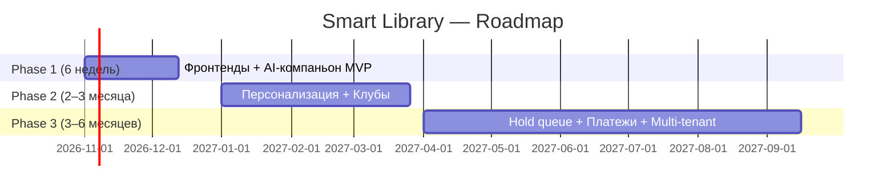

# 02. Roadmap

## Обзор фаз

---

## Phase 1 — Reader-facing MVP (~6 недель)

**Цель:** Доказать, что AI-компаньон + семантический поиск + wishlist удерживают читателя публичной библиотеки.

### Scope

| Модуль | Что входит | Путь в репо |
| --- | --- | --- |
| `services/frontend-web/` | Next.js витрина: каталог, семантический поиск (`Search`), карточки, «похожие книги» (`SimilarBooks`), SEO (SSR/ISR) | новый |
| `services/frontend-app/` | Vite PWA кабинет: wishlist, история выдач, AI-чат (Recommend + explanation), регистрация/вход | новый |
| `packages/ui/` | Общие UI-компоненты (кнопки, карточки книг, поиск) для обоих фронтендов | новый |
| book-service | продюсер событий `book.*`, wishlist, ratings, signals consumer | `services/book-service/` |
| ai-service | `Search`, `SimilarBooks`, `ExplainRecommendation`, `TrackRecommendClick`, `Recommend` (расширение: `explanation` в ответе) | `services/ai-service/` |
| notification-service | Mailpit в compose для E2E email | `docker-compose.yml` |
| Signals | `book.viewed`, `book.wishlisted`, `book.rated`, `ai.recommend.shown/clicked` → schema `signals` в `book-db` | `services/book-service/migrations/` |
| API Gateway | Маршрутизация `/v1/ai/*`, `/v1/loans/*`, `/v1/wishlist/*`, `/v1/ratings/*`, CORS, передача principal заголовками | `services/api-gateway/` |
| loan-service | Публикация `reading.progress` (владелец выдач) | `services/loan-service/` |

### Exit criteria (проверяемые)

| # | Критерий | Метрика | Порог | Как проверить |
| --- | --- | --- | --- | --- |
| P1-1 | Читатель проходит путь «поиск → карточка → AI-сессия → wishlist» | E2E-тест | Проходит | `e2e/` тест, CI |
| P1-2 | Семантический поиск возвращает релевантные результаты | Eval-набор (`services/ai-service/rag/evals/`) | precision@5 >= 0.40, hit@5 >= 0.60 | `scripts/eval-rag.ps1 -MinPrecision 0.40 -MinHitRate 0.60` |
| P1-3 | Сигналы пишутся в schema `signals` | `SELECT count(*) FROM signals.signal_events` | > 0 после E2E | Интеграционный тест |
| P1-4 | Email-уведомление о доступности книги из wishlist | Mailpit capture | Письмо получено | E2E-тест |
| P1-5 | Витрина индексируется поисковиками | robots.txt + sitemap.xml + SSR HTML | Карточка книги рендерится на сервере | Lighthouse SEO >= 90 |
| P1-6 | `tenant_id` во всех новых таблицах | Миграция | Колонка NOT NULL | `go test ./...` (check constraint violation при отсутствии) |
| P1-7 | Все модули собираются, тесты проходят | CI | Build + test green | GitHub Actions |

### Что НЕ входит в Phase 1

- Книжные клубы (Phase 2)
- Персонализация на истории выдач (Phase 2)
- Book companion Q&A с защитой от спойлеров (Phase 2)
- Telegram-бот: полноценный бот с поиском и статусом (Phase 2). Напоминания о сроке возврата и привязка `chat_id` перенесены в Phase 1b (#103, #104) по решению владельца продукта.
- Платежи, подписки (Phase 3)
- Multi-tenant RLS (Phase 3)
- Школьные/вузовские интеграции (Phase 2–3)
- Импорт из Goodreads/LiveLib (Phase 3)

---

## Phase 2 — Персонализация + Клубы (~2–3 месяца)

**Цель:** Социальный слой (клубы) + AI-персонализация на истории выдач.

### Scope

| Модуль | Что входит | Путь в репо |
| --- | --- | --- |
| `clubs-db` + user-service | `clubs`, `club_memberships`, `club_posts`, `club_questions`, `club_moderation` | новый DSN в user-service |
| ai-service | `AskAboutBook` (companion, защита от спойлеров), `GenerateClubQuestions` | `services/ai-service/` |
| book-service | Персонализация: `Recommend` учитывает `reading_progress` + историю выдач | `services/book-service/` |
| loan-service | Персональные подборки на основе накопленного `reading_progress` (публикация сигнала — в Phase 1) | `services/loan-service/` |
| frontend-app | Клубы: список, вступление, посты, вопросы | `services/frontend-app/` |
| frontend-web | Публичные страницы клубов (SEO) | `services/frontend-web/` |
| notification-service | Telegram Bot API: поиск, статус выдачи, история чата (в Phase 1 — только уведомления о сроке и `/start`) | `services/notification-service/` |
| user-service | `telegram_chat_id` в `users` (перенесён в Phase 1b, #103) | миграция |
| Аналитика | Панель библиотекаря: popularity, overdue-воронка, club engagement | `services/frontend-app/` (роль LIBRARIAN) |

### Exit criteria

| # | Критерий | Метрика | Порог |
| --- | --- | --- | --- |
| P2-1 | Читатель может вступить в клуб и написать пост | E2E-тест | Проходит |
| P2-2 | AI генерирует вопросы для обсуждения по книге | Eval (human review) | >= 7 из 10 вопросов «пригодны» |
| P2-3 | Персонализированная рекомендация конвертируется в выдачу | Wishlist → Loan conversion | >= 15% |
| P2-4 | Куратор получает AI-вопросы за < 10 сек | Latency p95 | < 10 000 мс |
| P2-5 | Club MAU / total readers | Метрика | >= 10% |
| P2-6 | Email-first: >= 90% писем доходят | Delivery rate | >= 0.90 |

### Что НЕ входит в Phase 2

- Hold queue, штрафы (Phase 3)
- Платежи (Phase 3)
- Kiosk PWA (Phase 3)
- Импорт из внешних каталогов (Phase 3)
- AI-модерация (Phase 3)
- Schema-per-tenant / database-per-tenant (отклонено, `07-non-goals-and-risks.md`)

---

## Phase 3 — Монетизация + Масштаб (~3–6 месяцев)

**Цель:** SaaS-подписка, hold queue, multi-tenant для 5–20 библиотек.

### Scope

| Модуль | Что входит |
| --- | --- |
| Billing (billing-db, user-service) | `billing.v1` proto, ЮKassa/Tinkoff webhook, `subscriptions`, `payments` |
| Hold queue (loan-service) | `holds`, `fines`, `ListHolds`, `CreateHold`, `CancelHold`, `ListFines`, `PayFine` |
| Multi-tenant | `tenant_id` в существующих таблицах (books, users, loans, ...), RLS-политики |
| Импорт каталогов | Goodreads API, LiveLib, Open Library — автообогащение |
| Acquisition analytics | Дашборд для администратора: wishlist-gap analysis |
| Kiosk PWA | Упрощённый UI для киоска в библиотеке |
| Telegram Bot | Полноценный бот: уведомления, поиск, статус |

### Exit criteria

| # | Критерий | Метрика | Порог |
| --- | --- | --- | --- |
| P3-1 | Библиотека может оплатить подписку онлайн | E2E (test mode ЮKassa) | Платёж прошёл, webhook обработан |
| P3-2 | Hold queue: читатель ставит в очередь | E2E-тест | Проходит |
| P3-3 | Multi-tenant: 2 библиотеки на одном деплое | Данные изолированы | Cross-tenant query = 0 |
| P3-4 | RLS включён на всех таблицах | Миграция + тест | `SET ROLE app_reader` → видит только свой tenant |
| P3-5 | Импорт из Open Library | 100 книг обогащены | < 5 мин на 100 книг |

### Что НЕ входит в Phase 3

- Нативное мобильное приложение (non-goal)
- Соцсеть «для всех читателей» (non-goal)
- Аудиокниги/ридер (non-goal)
- Универсальная библиотечная система vs Koha (non-goal)

---

## Scope фронтендов по фазам

| Фаза | `services/frontend-web/` (Next.js) | `services/frontend-app/` (Vite PWA) |
| --- | --- | --- |
| Phase 1 | Каталог, поиск (семантический), карточка книги, «похожие», SEO, sitemap | Регистрация, вход, wishlist, история выдач, AI-чат, ratings |
| Phase 2 | Публичные страницы клубов, «Книга месяца» | Клубы (вступление, посты, вопросы), панель библиотекаря, companion |
| Phase 3 | Публичная страница «_hold_» (статус очереди) | Kiosk PWA, платежи (redirect на hosted page), hold queue UI |

---

## Ссылки

- Декомпозиция Phase 1 на задачи и граф зависимостей: `docs/product/09-phase1-issue-dag.md`
- Метрики и пороги: `docs/product/08-metrics.md`
- Архитектурные изменения: `docs/product/03-architecture-deltas.md`
- Модель данных: `docs/product/04-data-model.md`
- API-контракты: `docs/product/05-api-additions.md`
