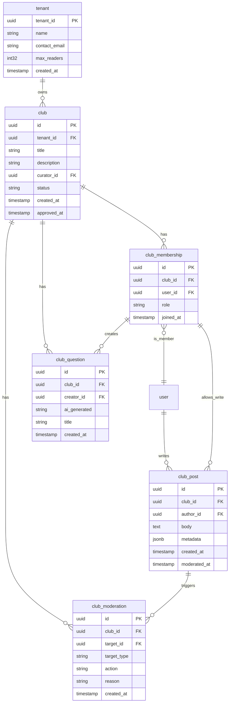

# 03. Architecture Deltas

## Обзор изменений

Этот файл описывает, **что меняется** в архитектуре проекта в результате принятия решений Q1–Q7. **Новые backend-микросервисы в этом наборе решений не появляются** — новые компоненты реализуются как:
- **Модули существующих сервисов** (signals в book-service)
- **Отдельные БД внутри существующих сервисов** (clubs-db, billing-db в user-service)
- **Фронтенд-приложения** (frontend-web, frontend-app — не backend-сервисы в смысле database-per-service)

---

## 1. Два фронтенда: Next.js витрина + Vite SPA кабинет

### Что меняется

Добавляются два фронтенд-приложения в монорепо:

| Приложение | Путь в репо | Стек | Зачем |
| --- | --- | --- | --- |
| Витрина (публичный каталог) | `services/frontend-web/` | Next.js (SSR/ISR) | SEO, быстрый TTFB, индексация в Яндексе/Google |
| Личный кабинет | `services/frontend-app/` | Vite + React + PWA (CSR) | Проще CI, дешевле хостинг, без Node-сервера в K8s |
| Общие компоненты | `services/frontend-web/packages/ui/` (локальный) | React + TypeScript | Делит кнопки, карточки книг, поиск между фронтендами |

### Обоснование (Q1)

**Почему гибрид, а не единый Next.js?**

| Критерий | Единый Next.js | Гибрид (Next.js + Vite) |
| --- | --- | --- |
| Публичная витрина (SEO) | ✅ SSR на всё | ✅ SSR только на витрину |
| Кабинет (интерактивность) | ✅ CSR внутри Next.js | ✅ CSR нативно |
| Хостинг (прод) | Node-сервер в K8s для всего | CDN (витрина) + CDN (кабинет) — **никого** |
| CI/CD | Один pipeline | Два pipeline (несколько job'ов в одном workflow) |
| Разделение команд | Нет (один рантайм) | Да (разные циклы деплоя) |
| Сложность | Проще, если фронтенд маленький | Сложнее, но дешевле в прод |

Для библиотеки витрина — публичная витрина: книги должны индексироваться. Кабинет — авторизованная зона: SEO не нужен, а поднимать второй Node-рантайм в K8s дороже, чем статика на CDN. Гибрид экономит на хостинге и позволяет независимые циклы деплоя.

### Что не меняется

- Бэкенд-микросервисы: `book-service`, `user-service`, `loan-service`, `notification-service`, `ai-service` — **без изменений** по количеству.
- API Gateway: маршрутизирует только к backend-сервисам, не к фронтендам.
- Фронтенды общаются с бэкендом через API Gateway (`:8080`) и REST/Swagger, сгенерированный из proto-контрактов (`google.api.http`).

### Диаграмма компонент

```mermaid
graph TB
    subgraph "Frontend (не сервисы)"
        FW["frontend-web/\nNext.js SSR\nCDN"]
        FA["frontend-app/\nVite PWA CSR\nCDN"]
    end

    subgraph "API Gateway"
        GW["api-gateway\n:8080\ngRPC-аутентификация"]
    end

    subgraph "Backend Services (database-per-service)"
        BS["book-service\n:8081\nbook-db (:5434)"]
        US["user-service\n:8082\nuser-db (:5432)"]
        LS["loan-service\n:8083\nloan-db (:5435)"]
        NS["notification-service\n:8084\n(RabbitMQ + SMTP)"]
        AIS["ai-service\n:8085\npgvector (:5436)"]
    end

    subgraph "Infrastructure"
        RMQ["RabbitMQ\n:5672"]
        N8N["n8n\n:5679"]
        PGV["pgvector\n:5436"]
    end

    FW --> GW
    FA --> GW
    GW --> BS
    GW --> US
    GW --> LS
    GW --> AIS
    GW -.healthz.-> NS

    LS -.loan.*.-> RMQ
    US -.user.*.-> RMQ
    BS -.book.*.-> RMQ
    NS -.consumes loan.*.-> RMQ
    AIS -.consumes book.*.-> RMQ

    AIS -.n8n.-> N8N
    AIS -.pgvector.-> PGV
```

---

## 2. Signals: schema `signals` внутри `book-db`

### Что меняется

- **Publisher:** сервисы-владельцы бизнес-операций (book-service, ai-service, loan-service) публикуют сигналы в `library.events` через `pkg/events`; отдельного фронтендового endpoint нет (implicit publish, см. диаграмму ниже).
- **Consumer:** book-service (новый пакет `internal/consumer/signals/`) подписывается на `book.#`, `loan.#`, `reading.#`, `ai.#`, пишет в schema `signals` в `book-db`.
- **События:** `book.viewed`, `book.created`, `book.updated`, `book.deleted`, `book.wishlisted`, `book.rated`, `loan.issued`, `loan.returned`, `loan.overdue`, `reading.progress`, `ai.recommend.shown`, `ai.recommend.clicked`, `ai.chat.asked` (whitelist — #92).
- **Владелец данных:** book-service (schema `signals` в `book-db`). Аналитика библиотекаря — read-only projection.

### Обоснование (Q2 A)

**Почему не отдельный signals-service?**
- Нарушает правило «не добавлять микросервисы без ADR» (`07-non-goals-and-risks.md`, ограничение 1).
- Signals — read-heavy для аналитики, write-heavy для consumer. Разделение заставило бы добавить ещё один процесс, один Dockerfile, одну CI-джобу.
- Book-service уже владеет каталогом и первым получает `book.*`-события. Сигналы привязаны к книгам.

**Почему не отдельная БД?**
- Задержка (latency) — сигналы пишутся при каждом просмотре/клике. Отдельная БД = ещё один DSN, ещё один round-trip.
- Масштаб: 5–20 библиотий * 1000 читателей * 50 событий/день = ~100K событий/день. Это легко для одной PostgreSQL.
- Отдельная schema (не отдельная БД) даёт физическую изоляцию без операционной нагрузки.

### Диаграмма sequence: сигнал

```mermaid
sequenceDiagram
    participant UI as frontend-web/app
    participant GW as api-gateway
    participant US as user-service
    participant BS as book-service
    participant EVT as RabbitMQ
             (library.events)
    participant SC as book-service
             consumer/signals
    participant DB as book-db
             schema: signals

    UI->>GW: GET /v1/books/{id}
    GW->>US: gRPC AuthenticateToken
    US-->>GW: Principal
    GW->>BS: gRPC GetBook
    BS-->>GW: Book

    Note over BS: implicit publish: use-case Get
    BS->>EVT: publish book.viewed
                   {book_id, tenant_id, occurred_at}

    GW-->>UI: Book (SSR)

    EVT->>SC: consume book.viewed
    SC->>DB: INSERT INTO signals.signal_events

    Note over UI: аналогично для wishlisted (#90), rated (#91),
    ai.recommend.shown / clicked (#94), reading.progress (#95)
```

> **Implicit publish (решение ревью Run 1, M7).** Отдельного эндпоинта `POST /v1/signals` в Phase 1 нет: сигнал публикует тот же use-case, который выполняет бизнес-операцию (чтение карточки, добавление в wishlist, оценка, рекомендация, отчёт о прогрессе). Отдельный endpoint означал бы дублирующий скоуп (валидация payload, авторизация, маппинг типов), которого нет ни в одной задаче DAG.
```

### Tradeoffs

| Вариант | Плюсы | Минусы |
| --- | --- | --- |
| (A) schema в book-db | Простота, один процесс, один Dockerfile, один CI | book-service становится шире (2 DSN, 2 schema) |
| (B) отдельная БД | Изоляция нагрузки | +1 процесс, +1 Dockerfile, +1 CI-джоба, сложнее локальная разработка |
| (C) отдельный сервис | Полная изоляция | Нарушает правило «без ADR — никаких новых сервисов» |

**Принято: (A).** book-service получает второй DSN (или тот же DSN с `search_path` на `signals`), новый пакет `internal/consumer/signals/`.

---

## 3. Клубы: `clubs-db` внутри user-service

### Что меняется

- **Владелец:** user-service (второй DSN `USER_SERVICE_CLUBS_DB_DSN`).
- **База:** `clubs-db` (отдельный PostgreSQL-контейнер в `docker-compose.yml`).
- **Таблицы:** `clubs`, `club_memberships`, `club_posts`, `club_questions`, `club_moderation`.
- **Все таблицы содержат `tenant_id UUID NOT NULL`** (Q5).
- **Куратор:** библиотекарь (LIBRARIAN) или назначенный читатель. Читатель может создать, но активирует — библиотекарь.
- **Модерация:** базовая (жалоба → очередь → скрытие/удаление). AI-модерация — Phase 3.

### Обоснование (Q3 D)

**Почему не новый микросервис?**
- Клубы — социальная сущность (участники, роли, посты). Ближе к user-service, чем к book-service.
- Новый сервис = новый proto-контракт, новый Dockerfile, новая CI-джоба, новый порт. Правило: без ADR — нельзя.
- Масштаб данных: 20 библиотек * 10 клубов * 20 постов/месяц = ~4K постов/месяц. Не требует отдельного сервиса.

**Почему не user-db?**
- user-db уже нагружена сессиями и пользователями. Клубы добавляют ещё один hot-write паттерн (посты, лайки, модерация).
- Отдельная БД снижает риск, что user-db станет bottleneck. Но тот же процесс = нет нового цикла деплоя.

### ER-диаграмма: клубы



### Tradeoffs

| Вариант | Плюсы | Минусы |
| --- | --- | --- |
| (D) clubs-db + user-service | Один процесс, один Dockerfile, нет нового сервиса | user-service становится шире (2 DSN) |
| (A) user-db | Проще локально | hot-write паттерн клубов конкурирует с сессиями за соединения |
| (C) club-service | Полная изоляция | Нарушает правило «без ADR — нельзя» |

**Принято: (D).** user-service получает второй DSN, новый пакет `internal/club/` (domain, service, repository, handler), новый контейнер `clubs-db` в `docker-compose.yml`.

---

## 4. Billing: `billing-db` внутри user-service (Phase 3)

### Что меняется

- **Владелец:** user-service (третий DSN `USER_SERVICE_BILLING_DB_DSN`).
- **База:** `billing-db` (отдельный PostgreSQL-контейнер).
- **Таблицы:** `subscriptions`, `payments`.
- **Proto:** `billing.v1` (новый proto-контракт).
- **PAN/CVV:** никогда не попадают в БД. ЮKassa/Tinkoff — hosted payment page или widget. Webhook идемпотентен.

### Обоснование (Q4)

**Почему не отдельный сервис?**
- Billing — линейка операций: подписка → платёж → webhook → обновление статуса. Не требует высокой нагрузки.
- user-service уже владеет пользователями и их ролями. Подписка — расширение роли LIBRARIAN.

**Почему ЮKassa/Tinkoff, а не Stripe?**
- Целевая аудитория — РФ-библиотеки. Stripe недоступен для РФ-юрлиц.

**Почему `tenant_id` в новых таблицах?**
- billing-db — новая БД, но мульти-тенантность нужна с первого дня (Phase 3).

### Tradeoffs

| Вариант | Плюсы | Минусы |
| --- | --- | --- |
| (A) module в user-service | Один процесс, логически связано с пользователями | user-service становится шире (3 DSN) |
| (B) отдельный billing-service | Изоляция | Нарушает правило «без ADR — нельзя» |

**Принято: (A).** Phase 3. В Phase 1 — **не реализуется**.

---

## 5. Multi-tenant: row-level (Q5 A)

### Что меняется

| Фаза | Что добавляется |
| --- | --- |
| Phase 1 | `tenant_id UUID NOT NULL` во всех **новых** таблицах (`signals.*`, `clubs.*`, `wishlist`, `ratings`, `holds`, `fines`) |
| Phase 2 | `tenant_id` в `reading_progress`, `club_posts`, `club_questions` |
| Phase 3 | `tenant_id` в **существующих** таблицах (books, users, loans, sessions, notifications) + RLS-политики |

### Обоснование

**Почему не schema-per-tenant?**
- 20 библиотий = 20 схем × 5 сервисов × 10 таблиц = 1000 миграций. Не масштабируется.
- Сложнее бэкап/восстановление.

**Почему не database-per-tenant?**
- 20 библиотий = 20 PostgreSQL-экземпляров. Операционная нагрузка: 20 * 5 = 100 БД.
- Для 5–20 пилотных библиотек избыточно.

**Почему `tenant_id` в Phase 1, а не Phase 3?**
- Добавить `tenant_id` сейчас — это `ALTER TABLE ... ADD COLUMN` (мгновенно).
- Ретрофит в Phase 3 — это переписывание всех запросов во всех пяти сервисах + миграции данных + RLS-политики. Дорого и рискованно.

**Почему RLS в Phase 3, а не Phase 1?**
- RLS — новая функция. В Phase 1 фильтрация в коде (`ctx` с tenant_id).
- RLS требует миграции существующих таблиц (Phase 3) + тестирования политик.

### Tradeoffs

| Вариант | Плюсы | Минусы |
| --- | --- | --- |
| (A) Row-level (tenant_id) | Простота, легко мигрировать к RLS, один стек | Фильтрация в коде (до RLS) — риск пропустить фильтр |
| (B) Schema-per-tenant | Физическая изоляция | 20+ схем, сложно бэкапить |
| (C) Database-per-tenant | Полная изоляция | 100 БД, операционная нагрузка |

**Принято: (A).** В Phase 1 — фильтрация в коде. В Phase 3 — RLS.

---

## 6. Email-first (Q7)

### Что меняется

- **Phase 1:** notification-service (SMTP) + Mailpit в `docker-compose.yml` для E2E.
- **Phase 1b:** Telegram Bot API в минимальном объёме — привязка аккаунта (`/start`) и напоминание о сроке возврата. Колонка `telegram_chat_id` в `users`. Перенесено из Phase 2 по решению владельца продукта (задачи #103, #104).
- **Phase 2:** Telegram Bot — поиск, статус выдачи, история чата.
- **Phase 3:** Полноценный Telegram Bot как самостоятельный канал обслуживания.

### Обоснование

**Почему email-first в Phase 1?**
- SMTP уже работает (notification-service готов, `pkg/events` → consumer → SMTP-транспорт).
- Mailpit дешёв для E2E.
- Публичная библиотека: читатели 18–55 лет, email достаточен.

**Почему Telegram урезан до напоминаний и перенесён в Phase 1b?**
- Telegram penetration ~70–80% в РФ, напоминание о сроке возврата — самый ценный сценарий, он же самый дешёвый: один транспорт Bot API (`sendMessage`) и одна колонка `telegram_chat_id`.
- Перенос сделан по явному решению владельца продукта, а не по валидации спроса: если email-канал в Phase 1 покажет достаточную открываемость, расширять бота (поиск, статус, чат) можно и позже.

---

## 7. Сводная таблица решений

| Вопрос | Решение | Файл | Раздел |
| --- | --- | --- | --- |
| Q1. Фронтенд: Next.js vs Vite SPA | Гибрид: Next.js витрина + Vite кабинет | `03-architecture-deltas.md` | Раздел 1 |
| Q2. Analytics/signals: где живут | Variant A: schema `signals` в `book-db` | `03-architecture-deltas.md` | Раздел 2 |
| Q3. Клубы: где живут | Variant D: `clubs-db` + user-service | `03-architecture-deltas.md` | Раздел 3 |
| Q4. Платежи: провайдер и время | ЮKassa/Tinkoff, Phase 3, модуль в user-service | `03-architecture-deltas.md` | Раздел 4 |
| Q5. Multi-tenant: модель | Variant A: row-level, `tenant_id` в Phase 1, RLS в Phase 3 | `03-architecture-deltas.md` | Раздел 5 |
| Q6. Целевой тип библиотеки | Публичная (городская/районная), Phase 1 | `01-personas.md` | Обзор сегментов |
| Q7. Канал уведомлений | Email-first (Phase 1), Telegram Bot API: напоминания + привязка (Phase 1b, #103), полный бот (Phase 2) | `03-architecture-deltas.md` | Раздел 6 |

---

## Ссылки

- Модель данных: `docs/product/04-data-model.md`
- API-контракты: `docs/product/05-api-additions.md`
- Сигналы и аналитика: `docs/product/06-signals-and-analytics.md`
- Non-goals и риски: `docs/product/07-non-goals-and-risks.md`
- Метрики: `docs/product/08-metrics.md`
- Задачи Phase 1 и граф зависимостей: `docs/product/09-phase1-issue-dag.md`
