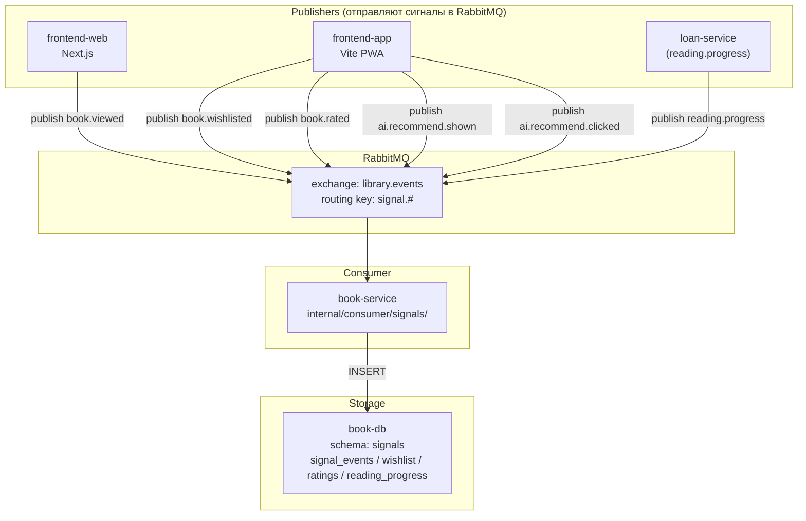

# 06. Signals and Analytics

## Обзор

Сигналы — основа персонализации (Phase 2) и аналитики библиотекаря (Phase 1–2). Собираются через готовый `pkg/events` (`publisher`/`subscriber`, `envelope`, AMQP-транспорт), пишутся в schema `signals` в `book-db`, агрегируются read-only projection для панели библиотекаря.

---

## Какие сигналы собираем

| Сигнал | Publisher | Consumer | Когда |
| --- | --- | --- | --- |
| `book.viewed` | frontend-web / frontend-app | book-service | Чтение карточки книги |
| `book.wishlisted` | frontend-app | book-service | Добавление в wishlist |
| `book.rated` | frontend-app | book-service | Оценка книги (1–5) |
| `reading.progress` | frontend-app | book-service | Обновление прогресса чтения |
| `ai.recommend.shown` | frontend-app | book-service | AI показал рекомендацию |
| `ai.recommend.clicked` | frontend-app | book-service | Клик по рекомендованной книге |

> **`reading.progress` — особый случай:** publisher — **loan-service** (владелец выдач). Когда читатель открывает книгу (через frontend-app), loan-service публикует `reading.progress` с `loan_id`. Consumer — book-service, schema `signals.reading_progress`.

---

## Схема события

Конверт события — `pkg/events/envelope.go`:

```json
{
  "event_id": "550e8400-e29b-41d4-a716-446655440000",
  "event_type": "book.viewed",
  "occurred_at": "2026-11-01T10:00:00Z",
  "schema_version": 1,
  "payload": {
    "reader_id": "550e8400-e29b-41d4-a716-446655440001",
    "book_id": "550e8400-e29b-41d4-a716-446655440002",
    "tenant_id": "550e8400-e29b-41d4-a716-446655440003",
    "source": "frontend-web",
    "session_id": "sess-abc123"
  }
}
```

### Поля payload по типу события

| Сигнал | Обязательные поля | Дополнительные поля |
| --- | --- | --- |
| `book.viewed` | `reader_id`, `book_id`, `tenant_id` | `source` (frontend-web/app/bot), `session_id`, `position` (процент прокрутки) |
| `book.wishlisted` | `reader_id`, `book_id`, `tenant_id` | `source` |
| `book.rated` | `reader_id`, `book_id`, `tenant_id`, `score` | `review` (текст) |
| `reading.progress` | `reader_id`, `book_id`, `tenant_id`, `percent` | `loan_id`, `chapter`, `page` |
| `ai.recommend.shown` | `reader_id`, `tenant_id`, `session_id` | `query`, `book_ids` (массив рекомендованных), `source` |
| `ai.recommend.clicked` | `reader_id`, `tenant_id`, `session_id`, `book_id` | `query`, `position` (позиция в списке) |

### Routing key и headers

- **Routing key:** `event_type` (например, `book.viewed`). Грамматика `<aggregate>.<action>` — `pkg/events/envelope.go:ValidateType`.
- **Headers:** `x-event-id`, `x-event-type`, `x-schema-version`, `x-occurred-at` — зеркалирование метаданных конверта (pkg/events/envelope.go:Headers).
- **Exchange:** `library.events` (topic exchange, ADR-0001).
- **Transport:** `pkg/events/amqp/transport.go` — publisher confirms, ручной ack, reconnect, TTL+DLX.

---

## Кто publisher, кто consumer



### Publisher: frontend → API Gateway → RabbitMQ

1. Frontend (Next.js или Vite) вызывает `POST /v1/signals` через API Gateway (`:8080`).
2. API Gateway проверяет токен через `AuthenticateToken` (user-service, gRPC).
3. API Gateway маршрутизирует к book-service.
4. Book-service (handler) валидирует payload, создаёт событие через `pkg/events.NewEvent()`.
5. Событие публикуется в RabbitMQ через `EventPublisher.Publish()` (`pkg/events/eventpublisher.go`).

### Consumer: book-service → signals schema

1. `internal/consumer/signals/` подписывается на `signal.#` через `pkg/events.Subscriber`.
2. Handler обрабатывает событие: декодирует payload, вставляет в соответствующую таблицу schema `signals`.
3. При ошибке — `nack` без requeue (`pkg/events/amqp/transport.go` — poison message → DLX).

---

## Где хранятся

| Данные | Таблица | Owner |
| --- | --- | --- |
| Сырые сигналы | `signals.signal_events` | book-service |
| Wishlist | `signals.wishlist` | book-service |
| Ratings | `signals.ratings` | book-service |
| Reading progress | `signals.reading_progress` | book-service |

**Владелец данных:** book-service (schema `signals` в `book-db`). Миграции — `services/book-service/migrations/002_signals.sql`.

---

## Агрегация в метрики библиотекаря

### Popular books

```sql
-- Самые просматриваемые книги за период.
SELECT book_id, count(*) AS views
FROM signals.signal_events
WHERE event_type = 'book.viewed'
  AND occurred_at >= NOW() - INTERVAL '30 days'
GROUP BY book_id
ORDER BY views DESC
LIMIT 20;
```

### Wishlist gap analysis (Phase 3)

```sql
-- Книги в wishlist, которых нет в каталоге.
SELECT w.book_id, count(*) AS wishlist_count
FROM signals.wishlist w
WHERE notified_at IS NULL
GROUP BY w.book_id
ORDER BY wishlist_count DESC
LIMIT 10;
```

### Overdue funnel

```sql
-- Воронка: viewed → wishlisted → rated → (loaned)
SELECT
    SUM(CASE WHEN se.event_type = 'book.viewed' THEN 1 ELSE 0 END) AS views,
    SUM(CASE WHEN se.event_type = 'book.wishlisted' THEN 1 ELSE 0 END) AS wishlisted,
    SUM(CASE WHEN se.event_type = 'book.rated' THEN 1 ELSE 0 END) AS rated,
    SUM(CASE WHEN se.event_type = 'ai.recommend.clicked' THEN 1 ELSE 0 END) AS ai_clicked
FROM signals.signal_events se
WHERE se.occurred_at >= NOW() - INTERVAL '30 days';
```

### Club engagement

```sql
-- Активность в клубах.
SELECT
    c.id AS club_id,
    c.title,
    COUNT(DISTINCT cm.user_id) AS members,
    COUNT(cp.id) AS posts,
    COUNT(DISTINCT cp.author_id) AS active_authors
FROM clubs c
JOIN club_memberships cm ON cm.club_id = c.id AND cm.left_at IS NULL
LEFT JOIN club_posts cp ON cp.club_id = c.id AND cp.hidden = false
GROUP BY c.id, c.title;
```

---

## Агрегация для AI-персонализации (Phase 2)

### Контекст для Recommend

Когда читатель запрашивает рекомендацию (`ai.recommend`), AI-сервис (через gRPC-клиент к book-service) запрашивает контекст:

```sql
-- Что читал и оценивал этот читатель.
SELECT book_id, score FROM signals.ratings
WHERE reader_id = $1
ORDER BY updated_at DESC LIMIT 20;

-- Что в wishlist.
SELECT book_id FROM signals.wishlist
WHERE reader_id = $1 AND notified_at IS NULL;

-- Прогресс чтения (для защиты от спойлеров в companion, Phase 2).
SELECT book_id, percent FROM signals.reading_progress
WHERE reader_id = $1;
```

**Что отдаём в LLM:**
- book_id, score (из `ratings`)
- book_id (из `wishlist`)
- book_id, percent (из `reading_progress`)

**НЕ отдаём в LLM (PII):**
- `reader_id` — заменяется на анонимный хеш
- `email`, `full_name`, `phone` — не участвуют в контексте
- Полная история `signal_events` — только агрегаты

---

## Приватность

### Что НЕЛЬЗЯ отдавать в LLM (ai-service / n8n)

| Данные | Причина |
| --- | --- |
| `reader_id` в открытом виде | PII. Заменяется на анонимный хеш в контексте |
| `email`, `full_name`, `phone` из `user-service` | PII. Не нужны для рекомендаций |
| Полная история чтения `reading_progress` | Приватность. Отдаём только `book_id` + `percent` |
| `tenant_id` + `reader_id` вместе | Может использоваться для деанонимизации |

### Opt-in для клубов

- Вступление в клуб — явное действие (`JoinClub`).
- Посты видны членам клуба и публично.
- Куратор может скрыть пост (модерация).

### Хранение сигналов

- `signal_events` — append-only таблица. Не удаляется автоматически (Phase 1).
- В Phase 3 — архивирование старых записей (`occurred_at < NOW() - INTERVAL '1 year'`).
- Экспорт данных по запросу читателя (152-ФЗ, Phase 3).

---

## Ссылки

- Событийная шина: `pkg/events/events.go`, `pkg/events/envelope.go`, `pkg/events/amqp/transport.go`
- ADR-0001: `docs/adr/0001-message-broker.md`
- Модель данных: `docs/product/04-data-model.md`
- Non-goals (приватность): `docs/product/07-non-goals-and-risks.md`
