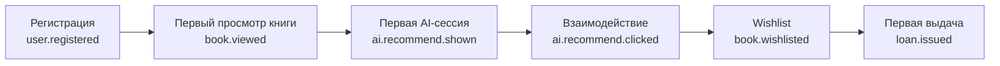

# 08. Metrics

## North Star Metric

> **AI-сессии на активного читателя в неделю (ASPWAR — AI Sessions Per Weekly Active Reader)**

**Определение:** количество завершённых AI-сессий (циклов «вопрос → ответ → взаимодействие с ответом») на одного читателя, активного хотя бы 1 раз за неделю.

**AI-сессия завершена**, если после ответа AI читатель:
- кликнул рекомендованную книгу (`ai.recommend.clicked`), или
- добавил книгу в wishlist (`book.wishlisted` из AI-ответа), или
- задал follow-up вопрос (в рамках `session_id`), или
- поставил оценку рекомендованной книге.

**ASPWAR = AI-сессий за неделю / уникальных читателей с хотя бы одним событием за неделю.**

---

## Воронка: регистрация → первая AI-сессия



### Цели по фазам

| Этап воронки | Фаза 1 цель | Фаза 2 цель | Событие |
| --- | --- | --- | --- |
| Регистрация → первый просмотр | >= 80% | >= 85% | `user.registered` → `book.viewed` |
| Первый просмотр → первая AI-сессия | >= 40% | >= 55% | `book.viewed` → `ai.recommend.shown` |
| AI-сессия → взаимодействие | >= 30% | >= 40% | `ai.recommend.shown` → `ai.recommend.clicked` |
| Взаимодействие → wishlist | >= 20% | >= 30% | `ai.recommend.clicked` → `book.wishlisted` |
| Wishlist → выдача | >= 10% | >= 15% | `book.wishlisted` → `loan.issued` |

**Time-to-first-value (регистрация → первая AI-сессия):** цель < 3 минуты (медиана).

---

## Retention

### D7 / D30 retention читателя

**Определение:** доля читателей, вернувшихся на 7-й / 30-й день после регистрации.

| Метрика | Фаза 1 | Фаза 2 | Измерение |
| --- | --- | --- | --- |
| D7 retention | >= 20% | >= 30% | `signal_events` (любое событие на 7-й день) |
| D30 retention | >= 10% | >= 20% | `signal_events` (любое событие на 30-й день) |
| D7 retention с AI-сессией | >= 35% | >= 50% | `signal_events` (AI-сессия на 7-й день) |

**Формула:**

```sql
-- D7 retention за период.
SELECT
    DATE(u.created_at) AS cohort_date,
    COUNT(DISTINCT u.id) AS registered,
    COUNT(DISTINCT CASE WHEN se.occurred_at::date = (u.created_at::date + 7)
                        THEN u.id END) AS retained_d7,
    ROUND(
        COUNT(DISTINCT CASE WHEN se.occurred_at::date = (u.created_at::date + 7)
                            THEN u.id END)::numeric
        / NULLIF(COUNT(DISTINCT u.id), 0), 4
    ) AS d7_rate
FROM users u
LEFT JOIN signals.signal_events se ON se.reader_id = u.id
WHERE u.created_at >= NOW() - INTERVAL '90 days'
GROUP BY cohort_date;
```

---

## Club Engagement

| Метрика | Фаза 2 цель | Измерение |
| --- | --- | --- |
| Клубов на библиотеку | >= 3 | `SELECT count(*) FROM clubs WHERE status = 'ACTIVE' AND tenant_id = $1` |
| Среднее число участников на клуб | >= 10 | `SELECT avg(cnt) FROM (SELECT count(*) cnt FROM club_memberships WHERE left_at IS NULL GROUP BY club_id)` |
| Постов на клуб в неделю | >= 5 | `SELECT count(*) / weeks FROM club_posts WHERE created_at >= NOW() - INTERVAL '30 days'` |
| Club MAU / total readers | >= 10% | Читатели с хотя бы одним событием в клубе / total readers |
| Retention клуба (D30 от вступления) | >= 40% | Читатели, активные в клубе на 30-й день после `club_memberships.joined_at` |
| Доля клубов с >= 1 AI-сессией/нед | >= 60% | `club_questions` + `ai.ask.shown` по клубу |

---

## Librarian Adoption

| Метрика | Фаза 1 цель | Фаза 2 цель | Измерение |
| --- | --- | --- | --- |
| DAU библиотекарей (на библиотеку) | >= 1 | >= 2 | `user.session.created` (роль LIBRARIAN) |
| Доля библиотекарей, использующих аналитику еженедельно | >= 50% | >= 80% | `GetSignalAnalytics` вызовы |
| Доля клубов под модерацией (>= 1 действие/нед) | N/A | >= 70% | `club_moderation` события |
| Время на рутину (модерация + напоминания) | <= 2 ч/день | <= 1 ч/день | Время между `club_moderation` записями |

---

## Support Metrics

### Wishlist → Loan conversion

**Определение:** доля книг из wishlist, которые были выданы в течение 30 дней после добавления.

| Фаза | Цель | Формула |
| --- | --- | --- |
| Phase 1 | >= 5% | `count(loans) / count(wishlist) WHERE loan.borrowed_at < wishlist.added_at + 30 days` |
| Phase 2 | >= 15% | То же |

### AI Recommendation Click-through Rate (CTR)

**Определение:** доля показанных рекомендаций, по которым был клик.

| Фаза | Цель | Формула |
| --- | --- | --- |
| Phase 1 | >= 15% | `count(ai.recommend.clicked) / count(ai.recommend.shown)` |
| Phase 2 | >= 25% | То же |

### Reading Completion Rate

**Определение:** доля книг, дочитанных до >= 90% (из `reading_progress`).

| Фаза | Цель | Формула |
| --- | --- | --- |
| Phase 2 | >= 40% | `count(reading_progress.percent >= 90) / count(reading_progress)` |

### Email Delivery Rate

**Определение:** доля писем, успешно доставленных (не bounce).

| Фаза | Цель | Формула |
| --- | --- | --- |
| Phase 1 | >= 90% | `1 - bounce_count / sent_count` (Mailpit capture) |

---

## North Star: ASPWAR по фазам

| Фаза | Цель ASPWAR | Измерение |
| --- | --- | --- |
| Phase 1 | >= 0.5 | `count(AI-сессий) / count(уникальных читателей за неделю)` |
| Phase 2 | >= 1.5 | То же (клубы + companion генерируют больше сессий) |
| Phase 3 | >= 3.0 | То же (Telegram-бот, hold queue, персонализация) |

**AI-сессия** определяется как событие из `signal_events`, где:
- `event_type IN ('ai.recommend.shown', 'ai.ask.shown')`
- `metadata->>'completed' = 'true'`

---

## Как измерять

### Источник данных

| Метрика | Источник |
| --- | --- |
| ASPWAR, воронка, retention | `signals.signal_events` (schema `signals` в `book-db`) |
| Club engagement | `clubs-db` (таблицы `clubs`, `club_memberships`, `club_posts`) |
| Librarian adoption | `user-db` (таблица `sessions`) + `signals.signal_events` |
| Wishlist → Loan | `signals.wishlist` + `loan-db.loans` |
| Email delivery | Mailpit API (`/api/v1/messages`) |

### Агрегация

- **Реал-тайм:** `GetSignalAnalytics` (book-service, LIBRARIAN) — read-only projection.
- **Batch:** cron-задача (Phase 2), пишет в материализованное представление `signals.daily_metrics`.
- **Дашборд:** `frontend-app` (роль LIBRARIAN), Phase 1 — базовые виджеты, Phase 2 — полные.

### События для метрик

| Метрика | Ключевые события |
| --- | --- |
| ASPWAR | `ai.recommend.shown`, `ai.recommend.clicked`, `book.wishlisted` (из AI) |
| Retention | Любое событие из `signal_events` |
| Club engagement | `club.joined`, `club.post.created`, `club.question.created` |
| Librarian adoption | `user.session.created` (LIBRARIAN), `GetSignalAnalytics` |
| Wishlist → Loan | `book.wishlisted` → `loan.issued` (join по `book_id` + `reader_id`) |

---

## Пороги для принятия решений

| Ситуация | Решение |
| --- | --- |
| ASPWAR < 0.3 к концу Phase 1 | Гипотеза AI-компаньона не подтверждена. Пересмотреть UX, не фичи. |
| D7 retention < 15% | Онбординг сломан. Проверить time-to-first-value. |
| AI CTR < 10% | Рекомендации нерелевантны. Проверить eval-набор (`evals/rag-eval-suite.json`). |
| Club MAU < 5% | Клубы не нужны в текущем формате. Пересмотреть механику (не отменять). |
| Librarian DAU = 0 | Продукт не нужен библиотеке. Сегмент выбран неверно. |

---

## Ссылки

- Product brief (North Star): `docs/product/00-product-brief.md`
- Сигналы и аналитика: `docs/product/06-signals-and-analytics.md`
- Roadmap (exit criteria): `docs/product/02-roadmap.md`
- Eval-набор: `services/ai-service/rag/evals/rag-eval-suite.json`
- Метрики eval: `services/ai-service/rag/evals/README.md`
